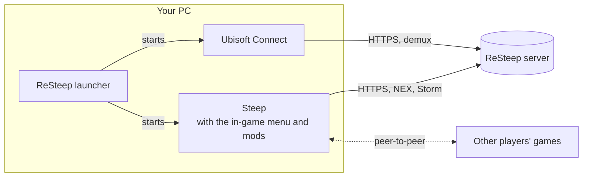

# How it works

Steep needs Ubisoft's online services for its progression, store, challenges and multiplayer, and only goes online
when Ubisoft Connect is online. ReSteep answers both in Ubisoft's place.

## The parts

| Part | What it does |
| --- | --- |
| **Server** (`powder-server`, Rust) | One program that answers the game and Ubisoft Connect: the UbiServices HTTPS API for all `*.ubi.com` hosts, the Quazal NEX online-session server, Ubisoft Connect's demux protocol and the Storm peer-to-peer helpers. Players, progress and mods' data live in SQLite. |
| **Launcher** (Python) | The ReSteep window. It checks and sets up what a start needs, starts Ubisoft Connect and Steep against the server, and manages mods and the local server. |
| **TLS helper** (native) | Makes the game accept the server's certificate, and only that one. |
| **In-game menu** (native, Dear ImGui) | The menu inside Steep, the Lua mods' host and the trainer. |
| **Linux session** (`powder-wrap`) | Runs Ubisoft Connect and Steep for one session in a private network under Wine or Proton, changing nothing on the system. |

ReSteep continues **Powder** (the server, the Linux session, the TLS helper and the tools, which keep that name:
`powder-server`, `powder-wrap`, the `/_powder/` routes) and **BlueBird** (the launcher window, the in-game menu and
Lua mods). What changed since Powder: [Coming from Powder](powder.md).

## Reaching the server instead of Ubisoft's

- **Windows:** nothing on the system changes. ReSteep's hook inside Ubisoft Connect points the Ubisoft names at the
  server, trusts its pinned certificate authority inside Connect's own processes only, and lets Connect reach nothing
  else. Steep gets the same through ReSteep's redirect and the TLS helper.
- **Linux:** the session gets its own network and a private `/etc/hosts` that points the Ubisoft names at the server
  running inside it. The certificate authority is trusted by the Wine prefix only while the session lasts. No hosts
  entries, no system certificate, no root.

## Certificates

The server makes its own certificate authority, restricted by name constraints to `ubi.com`, `ubisoft.com` and
loopback addresses, so it can't vouch for any other website. The launcher checks this before it trusts one, and pins
each server's certificate authority by its fingerprint on first use.

Steep checks certificates with its own OpenSSL. The TLS helper traps that check (after the game's start-up integrity
check) and accepts a chain only when the server's certificate is exactly the one the launcher pinned for this server.
Any other certificate is rejected as it would be without the helper. With nothing pinned, the game stays offline.
Game files are never modified on disk.

## How a request is answered

| | HTTPS | NEX (online session) |
| --- | --- | --- |
| 1 | A server mod's `before_http` hook | A server mod's `before_rmc` hook |
| 2 | The server's own logic | The server's own handler |
| 3 | The game-data pack's reply | The game-data pack's reply |
| 4 | An empty reply, logged as unmatched | An error, logged as unhandled |

## Progression

The game computes its progress itself and uploads it as stat events. The server maps each event to the stat it
updates with monotonic rules (maximum, sum, or bits set), so a stale upload can never lower a level or wipe an
unlock. Every upload is also kept as it came.

## Multiplayer

The game starts its multiplayer part only when its configuration names peer-to-peer helper servers (Storm). The
server runs them itself: NAT detection tells a game the address the server sees, and the traversal server passes a
game's "connect me to that player" on to the other game, so both send to each other at once (hole punching).
Matchmaking puts players in the same world and area into one session.

## Source code

[resteepMod/ReSteep](https://github.com/resteepMod/ReSteep): `server/` (Rust), `resteep/` (the launcher), `linux/`
(the Linux session), `native/` (the TLS helper, the in-game menu, the mod SDK), `tools/` (the game-data tools).
